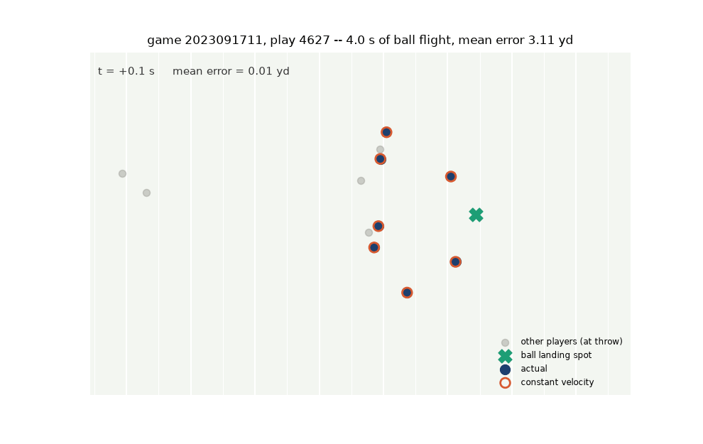
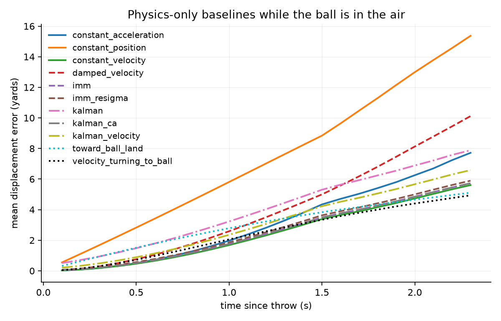
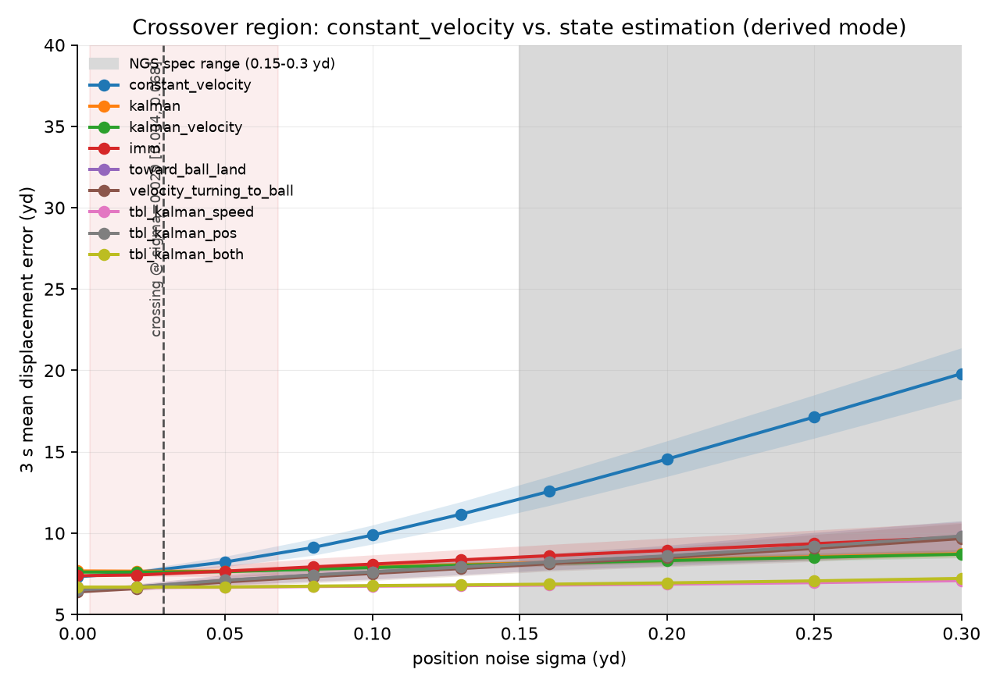
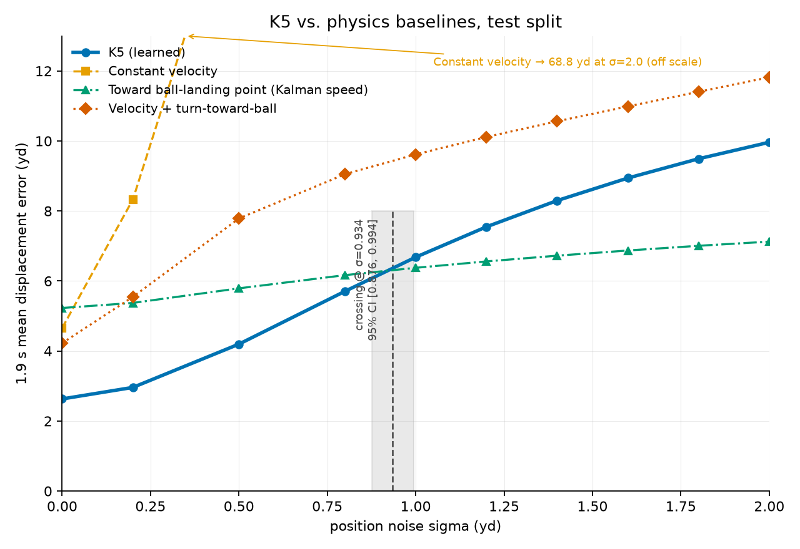
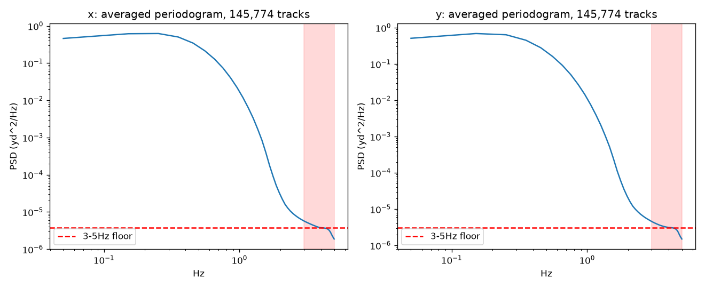
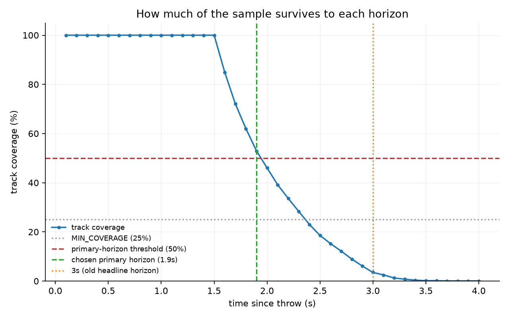

# Trajectory Prediction Under Sensor Degradation

Predicting where NFL players will be 1.9 seconds after a pass is thrown — and,
more interestingly, **measuring which prediction methods survive when the
tracking sensor gets worse.**

The dataset is NFL Next Gen Stats, a UWB installation reporting positions at
10 Hz. NFL Football Operations states only that the system *"charts individual
movements within inches"* — it publishes no numeric accuracy figure
([operations.nfl.com/gameday/technology/nfl-next-gen-stats](https://operations.nfl.com/gameday/technology/nfl-next-gen-stats)).
This project measured the published position stream directly rather than
assume a number: it is quantized to 0.01 yd, with no detectable white noise
above that step (see Methodology). Every result here is framed as *"what
happens to this method when you deploy it on cheaper hardware"* — but `σ=0`
in every experiment below means *this already-processed stream*, not raw
sensor output. See the note in Methodology before reading any crossing as a
statement about the real sensor.

For the full Part 1 physics-study detail (Tier 0a/0b, every baseline, the
Kalman/IMM/hybrid family, the coverage-guard failure and its fix, the R-convention
adoption) — see [PART1_DETAIL.md](PART1_DETAIL.md).

---

**TL;DR**

| | |
|---|---|
| **Best accuracy, held-out test** | a small GRU, **1.80 yd** @1.9 s — vs **4.18 yd** for the best physics baseline |
| **But** | that same model is unusable at σ = 0.2 yd of added noise — on top of an already-processed stream, not raw sensor output |
| **Fix** | noise-augmented training; the learned model then beats physics out to **σ = 0.93 yd** |
| **Mechanism** | the network learns a velocity gain of **~8.8** where physics gives **1.90** — a 4.6× amplifier pointed at the noisiest channel in the dataset |



One play — the longest ball flight in the dataset, chosen because the
motion is clearest at that length — over 4.0 s. The gap between the
filled (actual) and open (constant velocity) circles is what every
number in this document is trying to shrink.

The project's actual deliverable is not an accuracy number. It is a measured
answer to **"when should I use a learned model and when should I use a
Kalman filter?"**

---

## The question

Standard trajectory-prediction work ranks methods on clean data. This project
asks a different question:

> A tracking system's accuracy is a hardware purchasing decision. If I spend
> less on anchors, or deploy in a worse RF environment, **which of these
> methods degrades gracefully and which one falls off a cliff?**

So every experiment has the same shape: inject σ yards of Gaussian noise into
the player positions, recompute everything downstream, and measure the error
curve. σ = 0 is the control, and it means *no noise added on top of the
published NGS stream* — not *raw sensor output*, and not *noise-free*. That
stream is itself already quantized to 0.01 yd and vendor-processed (see
Methodology); every σ in this project is noise added on top of whatever
processing already happened before the data was published, not total sensor
noise. A reader who assumes σ=0 means raw UWB will misread every number
below.

---

## Headline results

### Clean data, held-out test split (41 games never touched during development)

| predictor | test @1.9 s (yd) |
|---|---|
| **K3** — GRU, no physics base | **1.80** |
| K2 — GRU residual on `velocity_turning_to_ball` | 1.87 |
| K1 — GRU residual on `tbl_kalman_speed` | 1.90 |
| K4 — GRU, Kalman-filtered velocity input | 1.91 |
| K5 — GRU, noise-augmented training | 2.50 |
| `velocity_turning_to_ball` (best physics) | 4.18 |
| `tbl_kalman_speed` | 5.23 |
| `constant_velocity` | 4.51 |

Every learned variant beats every physics baseline. The *worst* model beats
the *best* baseline by 40%.

**A re-derivation penalty, not a reporting error.** The table below scores
the same predictors but not quite the same inputs: its σ = 0 point
re-derives velocity from position — needed so σ > 0 is an apples-to-apples
comparison across the sweep — rather than using the tracking system's own
reported velocity. That costs each predictor a small, predictor-specific
penalty:

| predictor | clean | σ=0 (degradation pipeline) | penalty |
|---|---|---|---|
| `tbl_kalman_speed` | 5.23 | 5.23 | 0% |
| `toward_ball_land` | 4.46 | 4.50 | 0.9% |
| K5 | 2.50 | 2.63 | 5% |
| K3 | 1.80 | 1.99 | 10% |

This previews the velocity-gain mechanism explained below in "Why the
learned model breaks," and one part of it is structural rather than
correlational: `tbl_kalman_speed` never reads the provided
velocity column — its speed comes from a position-only Kalman filter run
over position history — so its re-derivation penalty is 0% *by
construction*, and, separately, it is also the slowest of the three to
degrade under injected noise (1.4×, error at σ=2.0 over σ=0, measured
within the degradation pipeline alone). That is a mechanism, not a
coincidence. K3 and K5 both read the column, both pay a penalty (10% and
5%), and both degrade faster (12.7× and 3.8×) — consistent with the same
mechanism, but with only two predictors that ordering is not a test of
it, and isn't claimed as one.

The σ = 0 column of the degradation table below is that pipeline's control
condition, not the clean measurement above. Compare within a table, not
across them.

### Under degradation — the result that matters

| σ (yd) | K3 | K5 | `tbl_kalman_speed` |
|---|---|---|---|
| 0.0 | 1.99 | 2.63 | 5.23 |
| 0.2 | **16.41** | 2.96 | 5.37 |
| 1.0 | 24.58 | 6.68 | 6.38 |
| 5.0 | 26.38 | 13.56 | 8.34 |

A naively-trained model collapses at σ = 0.2 — a small fraction of a yard of
*added* noise, on top of an already-processed stream. Noise-augmented
training moves the collapse point by a factor of five.

**Crossing point (test-measured): σ = 0.9338, 95% CI (0.876, 0.994)**

> Below that, use the learned model. Above it, use the filter.

The cross-validated estimate was 1.0552 — optimistic by 11%, because the
variant was selected on CV. The test number is the one reported.

---

## Why the learned model breaks

Velocity is not measured; it is computed by differencing adjacent positions:

```
v[t] = (x[t] − x[t−1]) / Δt
```

With Δt = 0.1 s, this amplifies position noise by `√2/Δt ≈ 14×`. At σ = 0.2 yd
the velocity feature carries 2.83 yd/s of noise against true speeds of
3–8 yd/s — the *direction* of the velocity vector is essentially randomised.

Physics integrates that channel with a gain fixed at the horizon (1.9 s).
The network's gain is whatever training found optimal, and in training the
velocity channel was reliable:

| | velocity gain | vs physics |
|---|---|---|
| physics (integration) | 1.90 | 1.0× |
| K3 (clean training input) | **~8.8** (8.78–8.89) | ~4.6× |
| K4 (Kalman-filtered input) | 1.6–2.1 | ~0.8–1.1× |
| K5 (noise-augmented) | 0.46–0.56 | ~0.24–0.29× |

Monotonic, in the predicted direction, and **nothing here was hand-tuned** —
each gain emerged from training.

> **A learned model calibrates its sensitivity to each input according to that
> input's reliability during training. When deployment reliability changes,
> the learned gain is wrong — and nothing in the model knows it.**

A Kalman filter has `R` for exactly this. You read the new sensor's spec off
the datasheet and change one number. There is no equivalent for a trained
network short of retraining.

K3's soft failure threshold is σ = 0.00276 — below the published data's own
0.01 yd quantization step (see Methodology). A model with a gain of 8.8 fails
at a noise level the data cannot even represent. Monitoring cannot cover for
that; the model has to be fixed.

---

## Part 1 — the physics study

Six closed-form baselines, then Kalman / constant-acceleration / IMM filters,
then a hybrid. The unifying concept is **baseline length**:

```
angular error ≈ measurement noise / baseline length
```

| direction source | baseline | angular error |
|---|---|---|
| differencing adjacent frames | 0.6 yd | ±33° |
| bearing to the ball's landing point | 25 yd | ±0.6° |



`constant_position` (orange) — no velocity at all — diverges fastest and
worst; every baseline that uses velocity clusters well below it.

Four findings:

1. **Filtering is a losing trade on clean data, and when it stops being one
   depends on which baseline you ask.** Isolating the cost of smoothing
   alone — `tbl_kalman_speed` vs. `toward_ball_land`, identical except for
   where speed comes from (Kalman posterior vs. NGS's own reported speed),
   measured on held-out clean data — costs **0.77 yd**.
   - `tbl_kalman_speed` vs. **`constant_velocity`** crosses at **σ = 0.075**:
     the hybrid is worth it in place of the simplest baseline almost
     immediately as noise is added.
   - `tbl_kalman_speed` vs. **`toward_ball_land`** — the same-direction,
     speed-only isolation above — crosses at **σ = 0.1432** (95% CI
     0.1355–0.1513). What this means relative to the real sensor's own
     accuracy is unknown — see Methodology on why no such comparison can be
     supported from this data. The crossing itself, and the 0.77 yd cost
     below it, stand as measurements.
2. **Differentiation amplification.** `constant_velocity` degrades 37.7×; the
   hybrid degrades 1.8×.



`constant_velocity` (blue) is the only baseline that moves much across
this range; the other eight — Kalman, IMM, and the toward-ball-land
hybrid family — stay flat. Position noise is injected and velocity
re-derived at every sigma including 0, so this figure's sigma=0 is the
degradation pipeline's own control condition, not the clean baseline
table above.

3. **Corrupting player positions hurts 6–43× more than corrupting the landing
   point**, because only the former passes through a derivative.
4. **Clean-data rankings are actively misleading.** The clean-data winner
   finishes last at σ = 5.

---

## Part 2 — the learned models



K5 against the three physics baselines this project uses throughout. K5
leads until sigma is about 0.93; the shaded band is where that lead could
statistically end, not a single point. The crossing was verified against
the pointwise best of all 13 baselines and is unchanged.

Every point here, including sigma = 0, comes from the degradation
pipeline, which re-derives velocity from position rather than using the
tracking system's own velocity output. That alone costs K5 5% (2.50 ->
2.63 yd), so this figure's sigma = 0 column is a control condition, not
the clean measurement quoted in Headline results. Compare within a
pipeline, not across them.
*(Legend code identifiers: "K5 (learned)" = `K5`; "Constant velocity" =
`constant_velocity`; "Toward ball-landing point (Kalman speed)" =
`tbl_kalman_speed`; "Velocity + turn-toward-ball" =
`velocity_turning_to_ball`.)*

Five variants. Same architecture, folds, seed, features and loss; **each
changes exactly one thing** relative to K3.

| variant | change from K3 | question it answers | result |
|---|---|---|---|
| **K3** | — (baseline) | How good is a plain GRU? | Best on clean data |
| K1 | residual on `tbl_kalman_speed` | Does a physics base help? | **No** |
| K2 | residual on `velocity_turning_to_ball` | Does a *different* base help? | **No** |
| K4 | Kalman-filtered velocity input | Does cleaning the input help? | Partially |
| K5 | noise augmentation in training | Does training under noise help? | **Yes, decisively** |

K1/K2 failing is informative: a physics base only helps where the physics is
*right*. `velocity_turning_to_ball` is well-specified for targeted receivers
(where K1/K2 do beat K3) and mis-specified for defenders, who do not run at
the landing point. Defenders are 76% of the evaluation population, so the
network spends capacity undoing the base and loses overall.

The architecture is deliberately small: a single GRU layer, hidden size 64,
**18,050 parameters** against roughly 303,000 target values. Memorisation is
not available to it.

---

## Part 3 — serving latency and cost

Measured against a real SageMaker real-time endpoint (`ml.m5.large`, K5 only,
us-west-2, client in Vancouver), against a 10 Hz sensor's ~100 ms frame
budget.

**Round-trip decomposition** (batch 2, client p50 36.61 ms):

| component | time | share | source |
|---|---|---|---|
| model compute | 0.3 ms | 0.8% | local timing (Phase 1) |
| container, other | 8.8 ms | 24% | CloudWatch `ModelLatency` (avg 9.11, max 24.58) |
| SageMaker routing | 6.2 ms | 17% | CloudWatch `OverheadLatency` (avg 6.24, max 34.75) |
| network | 21.3 ms | 58% | client total minus the two above |

The model itself is 0.8% of the round trip. Cold start (the first request
after the endpoint comes up) is 109.5 ms server-side alone —
`ModelLatency` 47.3 ms + `OverheadLatency` 62.2 ms — over budget before the
network is even counted.

**Region**, interleaved so both saw the same network conditions:

| region | p50 | p95 | p99 | min |
|---|---|---|---|---|
| us-west-2 | 34.1 ms | 48.4 ms | 57.3 ms | 28.7 ms |
| us-east-1 | 91.1 ms | 110.6 ms | 124.5 ms | 83.9 ms |

Delta p50 +57.0 ms, delta min +55.2 ms — the two deltas agreeing means this
is propagation distance, not congestion. Moving the model ~4,000 km costs
+57 ms; the model itself costs 0.3 ms. A factor of 190.

**Batch size** (22 players is one play, the natural serving unit):

| batch | sent | returned | p50 | ms/player |
|---|---|---|---|---|
| 2 | 297 B | 3,672 B | 34.0 ms | 17.0 ms |
| 22 | 10,004 B | 40,123 B | 42.9 ms | 1.9 ms |

11–34× the payload costs 1.26× the latency. Batching a full play's worth of
players into one request drops the per-player cost 9×; the round trip is
dominated by fixed cost, not by what's in the request.

**p99 is not a single number.** Six rounds, batch 22, 40 s apart:

| metric | range | variation |
|---|---|---|
| p50 | 38.8–45.8 ms | 1.18× |
| p99 | 76.2–101.7 ms | 1.33× (one round over budget) |
| max | 83.3–151.5 ms | 1.82× |

An earlier single run reported p99 as 68.9 ms and was described as
comfortably inside budget — that was the optimistic end of this range, not
a representative value. Corrected: p99 is 76–102 ms, sitting *on* the
budget line, not under it. For a 10 Hz hard real-time loop, the nearest
cloud region is already marginal; real headroom needs a deployment closer
than Oregon — in-stadium, or same metro.

**Throughput — a load test I got wrong, and chased down.** First attempt
(threads, batch 22): throughput saturated at ~30 req/s, latency grew
linearly with concurrency, and Little's Law (latency = concurrency /
throughput) matched the measured values to within 2–6% (predicted
293/586/1,115 ms vs. measured 276/562/1,133 ms at concurrency 8/16/32). It
looked like a textbook endpoint-saturation curve.

It was not the endpoint — server-side `ModelLatency` stayed at 9.5–12 ms
throughout. Three hypotheses, each tested cheaply rather than assumed:

| hypothesis | test | result |
|---|---|---|
| Python GIL | multiprocessing, 8 procs × 8 threads | 35–38 req/s — not it |
| requests dropped | CloudWatch `Invocations` count | 9,532 sent, 9,532 received — not it |
| client bandwidth | shrink the response 11× (batch 2) | throughput up 5.9× — that's it |

Two ceilings, and which one binds depends on payload size:

- **batch 22**: client bandwidth, ceiling ~38 req/s = 12.4 Mbit/s.
  `ModelLatency` 35 ms — the endpoint is working, not saturated.
- **batch 2**: the endpoint itself, ~200 req/s. `ModelLatency` 143 ms, 14×
  its idle 9 ms. Client traffic only 6.7 Mbit/s, so bandwidth wasn't
  binding here.

The endpoint's real capacity was measured after all — at batch 2, ~200
req/s — without the in-region load generator this originally looked like
it would need. Shrinking the response was enough.

**Cost.** A game's load is 22 players × 10 Hz = 10 req/s. Measured headroom
is 4–20×, depending on which ceiling binds (client bandwidth at batch 22,
the endpoint itself at batch 2). `ml.m5.large` ≈ $0.12/hr, so a 3-hour game
≈ $0.35.

**What this means for the model choice.** Part 1/2 chose between physics
baselines and the five learned variants on accuracy and robustness alone.
Latency turns out not to be a third axis worth weighing: all three
candidates' compute (K5's 0.3 ms, K3's, and `tbl_kalman_speed`'s) is swamped
by a ~36 ms serving floor that has nothing to do with which model sits
behind it. Part 2's conclusion stands unchanged — now for a measured reason
instead of an assumed one.

---

## Methodology

This is the part worth reading if you are evaluating the engineering rather
than the football.

**What `σ=0` actually is, and what the sensor's real noise actually is.**
NFL Football Operations publishes no numeric accuracy figure for NGS — only
that it *"charts individual movements within inches."* This project measured
the published position stream directly rather than carry forward an assumed
number. Three checks, cheapest first: (1) `x`/`y` in the raw files are exact
multiples of 0.01 yd, no exceptions; (2) the distribution of `x[t]-x[t-1]` is
discrete — 100.00% of successive differences land exactly on the 0.01 grid,
nothing in between; (3) an estimator built to detect additive noise (a
difference-order ladder, validated end-to-end by injecting a known σ=0.10
into real motion and recovering 0.1001) finds no white noise above the
quantization step in the real data. **Conclusion: the published stream is
quantized to 0.01 yd and carries no detectable sensor noise above that — not
because the sensor is that precise (no UWB system achieves millimetre
accuracy), but because whatever noise the raw sensor has was removed before
publication.** `σ=0` in every experiment in this project means *this
already-processed stream*, not raw sensor output, and every σ>0 is noise
added on top of it, not total sensor noise. No comparison of a measured
crossing to "the sensor's accuracy" is supported by this data, and none is
made below. Full measurement detail, including the PSD check and why its
apparent high-frequency rolloff turned out to be a windowing artifact (caught
by re-running it on synthetic white noise before trusting it) rather than
evidence either way, is in PART1_DETAIL.md.



The apparent rolloff above ~1 Hz is a windowing artifact, not measured
sensor noise, confirmed by re-running this same check on synthetic white
noise before trusting it. This figure alone is inconclusive; the
quantization check above it is decisive.

**Splits by game, not by play.** Plays within a game share players and
schemes; a play-level split leaks that structure. 272 games → 190 train /
41 val / 41 test, fixed by seed, IDs written to disk.

**5-fold grouped cross-validation** over the 231 train+val games for all
development decisions. Every play receives an out-of-fold prediction, and the
fold-to-fold spread is a free error bar.

**The K5/physics crossing sigma is a play-level bootstrap estimate**
(1,000 resamples, seed 0), which is what the point estimate and 95% CI
quoted above come from. An independent estimator — linear interpolation on
the aggregate mean-error curves — gives 0.921 on the same test split,
consistent with the bootstrap estimate and well inside its interval.

**That crossing was checked against all 13 physics baselines, not just the
three plotted.** Only 3 had ever been scored under noise on the test split;
the other 10 (`scripts/run_tier1_test_degrade_allbaselines.py`) hadn't. `tbl_kalman_speed`
turns out to be the pointwise-best baseline at every σ across the entire
bracket the crossing lives in (0.8–2.0), so the crossing computed against
the full 13-baseline envelope is identical to the one reported — not just
close, bit-for-bit identical, because the envelope and `tbl_kalman_speed`
are the same curve there.

**All reported errors are micro-averages over tracks**
(`masked_error_at_step`, n = 888 on the test split), not macro-averages
over plays. Recomputing with equal weight per play gives different
numbers that are not comparable to anything reported here.

**The test split was opened exactly once**, after all five final models had
trained, with every variant and all 13 baselines scored in the same pass. The
early-stopping slice was drawn from the 231, never from test.

**A coverage guard that actually fires.** Only ~3.5% of plays have a ball
flight reaching 3 seconds. The project's original headline horizon was 3 s —
measured, at one point, on 24 tracks. `MIN_COVERAGE` existed in the config but
was wired only into the plotting path. The primary horizon is now 1.9 s
(53% coverage) and every reported number carries its coverage.

> A guard that only fires on plots is not a guard.



Coverage falls off sharply after 1.5s; the old 3s headline horizon
covers just 3.5% of tracks, which is why this project's primary horizon
is 1.9s (53% coverage) instead.

**The model's first result was audited rather than reported.** The GRU's
initial score was 57% better than the best physics baseline. That is not a
plausible margin for an 18k-parameter model, so it was investigated in three
layers before being written down:

1. *Scoring* — is the model measured with the same ruler as the baselines?
   (Two independently written implementations agreeing to four decimals.)
2. *Alignment* — is the model predicting the same instant it is scored at?
   (Histogram of which truth frame each prediction lands closest to.)
3. *Features* — is any future information reachable from the inputs?
   (Input tensors de-normalised back to field coordinates and searched
   against the output window.)

All three came back clean. The evidence that settled it was counter-intuitive:
**at step 1 the model's error is 0.40 yd against the baseline's 0.04 — ten
times worse.** A model with access to the answer does not lose anywhere.

Then, separately, a mechanism for the 55% was required before the number was
reported at all. A good number without a mechanism is as untrustworthy as an
unaudited one.

---

## Reproducing

Environment setup, Kaggle data download, and run order (sanity checks →
Part 1 → Part 2 → test split → Part 3's local half) — budget ~2.5–3 hours
end to end on CPU. Full commands: [REPRODUCING.md](REPRODUCING.md).

## Repository layout

```
config.py, data_loader.py, model.py, kalman.py, imm.py, hybrid.py,
baselines.py, evaluate.py, cache_pipeline.py, degrade.py, animate.py
                    — library modules, at the repo root
scripts/            — every run/test script (46 files)
outputs/            — figures, summary CSVs, checkpoints
deploy_k5/          — the packaged K5 artifact deployed for Part 3
data/               — Kaggle data, not committed
README.md           — this file
REPRODUCING.md       — full run order and per-script annotations
PART1_DETAIL.md      — full physics-study writeup
CONTEXT.md           — development working notes
TIER2A_RESULTS.md    — drift-detection work, not carried forward
```

Full per-script listing: [REPRODUCING.md](REPRODUCING.md).

---

## Limitations

- **"Truth" is itself a measurement.** The target positions come from NGS, not
  from physical ground truth. Everything here measures agreement with NGS, not
  with reality.
- **Single-player features.** The network sees one player's history, the ball's
  landing point, and a role flag. It cannot see the other 21 players — which
  is why its gains on defensive coverage come from correcting a mis-specified
  baseline rather than from modelling interaction.
- **The landing point is given.** A deployed system would estimate it from the
  same noisy stream. This is tested as a second degradation axis, but with an
  isotropic Gaussian, which a real landing-point estimator's error is not.
- **IMM's robustness is conditional.** Frozen-R testing shows most of the
  Kalman family is structurally robust, but IMM degrades 4.4× when `R` is not
  updated — its model-selection likelihood is parameterised by `R`.
- **3-second horizon numbers are not trustworthy** (~3% coverage). They are
  reported alongside their coverage, never alone.
- **Monitoring was explored and not carried forward.** Drift-detection
  signals were built and evaluated but are not part of this project's
  conclusions; see `TIER2A_RESULTS.md`, not summarised here.
- **The batch-22 endpoint ceiling is an estimate, not a measurement**
  (~90 req/s, extrapolated from the measured batch-2 figure). The client's
  own bandwidth bound throughput at batch 22 before the endpoint did;
  measuring the endpoint's batch-22 ceiling directly needs an in-region
  load client, which this project didn't build.
- **Only K5 was deployed.** `tbl_kalman_speed`'s local batch-22 cost
  (8.93 ms) vs. K5's (0.63 ms) suggests a Kalman endpoint would add roughly
  51 ms to the round trip — still inside the 100 ms budget — but that is an
  estimate from local CPU timing, not a measurement on `ml.m5.large`.
- **The p99 range (76–102 ms) was sampled in one afternoon, 40 s apart.**
  It is that window's range, not a range across times of day — a
  cross-time-of-day sample could be wider.

---

## Notes on process

Sixteen forward predictions were written down before the experiments that
would test them. **Three were correct.**

That ratio is in the repository on purpose. The checks in this project are
reliable; the guesses about what they would find were not. Six hypotheses were
stated specifically enough to be killed, and were:

| hypothesis | outcome |
|---|---|
| The 57% gap is a metric mismatch | Refuted — scoring was clean |
| Role inversion proves leakage | Withdrawn — physics is simply wrong for defenders |
| The degradation curve has a threshold | Refuted — smooth and concave |
| Gate saturation is the mechanism | Refuted — saturation *decreases* under noise |
| K4 keeps the same gain with a cleaner input | Refuted — the gain itself changed |
| K5 rediscovered the hand-designed solution | Refuted — shared mechanism, not shared solution |

In several of these the replacement explanation was better than the original.
That is the argument for writing hypotheses down in a form that can lose.

A seventh, from serving rather than modelling: the Part 3 throughput
sweep's first attempt (threads, batch 22) produced a textbook saturation
curve — latency grew linearly with concurrency and matched Little's Law
(latency = concurrency / throughput) to within 2–6%. It was not measuring
the endpoint: server-side `ModelLatency` stayed flat at 9.5–12 ms
throughout. Three candidate explanations were tested cheaply rather than
assumed — the Python GIL (ruled out: multiprocessing only moved throughput
from ~30 to ~35–38 req/s), dropped requests (ruled out: CloudWatch
`Invocations` matched sent exactly, 9,532/9,532), and client bandwidth
(confirmed: shrinking the response 11× by dropping to batch 2 raised
throughput 5.9×). The real result was two ceilings, not one — at batch 22
the client's own bandwidth binds first; at batch 2 the endpoint does, at
~200 req/s with `ModelLatency` 14× its idle value. A clean curve that
satisfies a textbook law is still only as informative as what it's
actually measuring.

Every incorrect number this project has had to correct — the 0.23 lag
figure, the NGS accuracy range, a p99 taken from a single run, and a
test-split crossing sigma reported without its competing estimator — shared
one property: it existed in conversation and never in a file. The numbers
that came from committed outputs have all held up.
